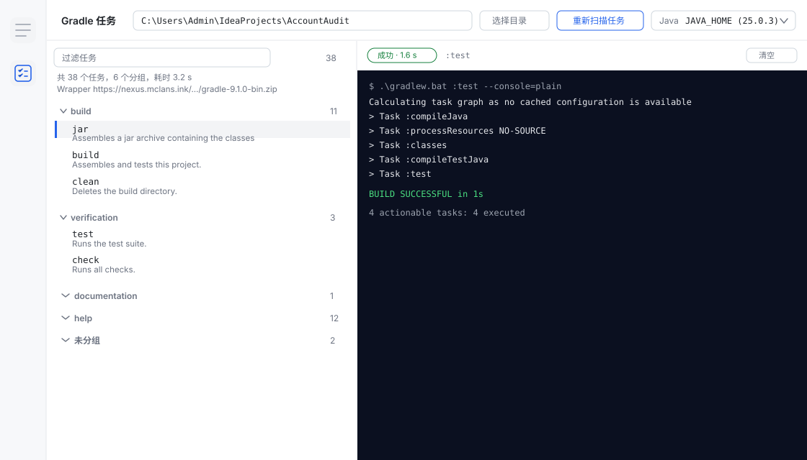

# dsh-gradle-tasks

在 DSH Web 界面的左侧主导航中增加一个「Gradle 任务」面板：识别当前会话所在项目是否为 Gradle 工程，按任务声明的 `group` 分文件夹列出全部任务，双击任务即用项目自带的 wrapper 与选定的 JDK 运行，构建输出实时回传到面板内置终端。



## 功能

| 功能 | 说明 |
| --- | --- |
| Gradle 工程检测 | 从当前会话目录向上查找 `settings.gradle[.kts]` / `build.gradle[.kts]`，命中最先出现的目录即为构建根目录；同时读取 wrapper 名称与 `distributionUrl` |
| 任务枚举 | 注入初始化脚本 `dump-tasks.gradle`，在 `gradle.projectsEvaluated` 阶段遍历 `allprojects` 下全部 `tasks`，写回 `路径 / group / description` 三列清单 |
| 分组显示 | 按任务的 `group` 分文件夹，文件夹按名称排序、「未分组」排在最后；文件夹内按 `description` 排序，无描述的任务排在后面，最终以任务路径兜底 |
| wrapper 优先 | 优先使用项目自带的 `gradlew.bat` / `gradlew`；项目没有 wrapper 时才回退到 `PATH` 中的 `gradle`，两者都没有则明确报错 |
| 双击运行 | 双击任务即运行；任务路径先按 `:project:task` 形式校验，`--init-script` 一类选项形状的输入在启动进程前就被拒绝 |
| 实时输出 | 运行输出经 NDJSON 流回传，面板终端保留最近 30 万字符；构建结束即关闭响应，运行期间可「停止」终止整棵进程树 |
| JDK 选择 | 扫描环境变量中的 `JAVA_HOME`、`JAVA_8`、`JAVA_17`… `JDK_HOME` 等，逐个校验 `bin/java[.exe]` 并读取 `release` 中的 `JAVA_VERSION`；默认选中 `JAVA_HOME`，切换后按新 JDK 重新扫描任务 |
| 目录覆盖 | 面板标题栏可直接填写绝对路径，或调用宿主目录选择器，用于查看当前会话之外的项目；选择结果记入 `localStorage` |

## 兼容版本

针对 DSH `0.2.2-rc.x` 编写与验证，`engines.dsh` 为 `>=0.2.2-rc.2 <0.3.0`。

宿主端只依赖公开服务：`webServer`、`connection`、`subprocess`、`sessions`、`workingDirectory`。运行期不导入任何 `@deepseek-ai/*` 值，接口形状以 `interface` 就地声明，因此插件不会因上游包的小版本调整而失效。客户端产物同样不引入宿主内部包，只使用 `slots` 与可选的 `locale`、`sidebarRight`、`uiWorkspace` 服务。

## 构建

开发需要 Node.js `>=22.6.0`（`npm test` 依赖原生 TypeScript 类型剥离；DSH 自身另有更高的运行时要求）。

```powershell
npm install --no-audit --no-fund
npm run typecheck
npm run build
npm test
```

`src/` 为 TypeScript 源码，运行期加载 `lib/` 中的产物。客户端入口 `src/client/index.tsx` 由 `tsdown` 编译为 CommonJS 并包进 `window.__ModuleLoader__.load({ id: "dsh-gradle-tasks", ... })` 闭包；构建配置见 [tsdown.client.config.mjs](tsdown.client.config.mjs)。修改客户端源码后需重新构建并刷新页面，修改宿主端源码后需重启 DSH 进程（Node 的 ESM 缓存按 URL 驻留）。

`npm test` 覆盖且仅覆盖本仓库的算法与解析逻辑：Gradle 工程定位、任务清单解析、分组排序、命令行拼装、JDK 变量筛选与排序。业务编排、路由处理与界面渲染不写测试。

## 安装

通过 `plugin_manager` 安装本目录，或执行：

```powershell
dsh plugin --profile web add <本目录绝对路径>
```

`cordis.patch.yml` 只插入一行宿主入口：

```yaml
- insert:
    - id: gradle-tasks
      name: 'dsh-gradle-tasks'
```

安装并重启后，左侧导航栏出现「Gradle 任务」图标，点击即可打开面板。

## 运行时行为

### 工程检测

从当前会话的工作目录开始逐级向上，最多 12 层。同一层同时存在 settings 与 build 脚本时以该层为根；只有 build 脚本的目录视为独立项目，同样作为根。

### 任务清单

任务清单来自一次真实的 Gradle 调用：

```text
<wrapper> --quiet --console=plain -p <root> --init-script <dump> -PdshGradleTasksOut=<report> help
```

初始化脚本在构建配置完成后执行，因此插件注册的任务、settings 脚本注册的任务都在清单内。`help` 任务本身也会出现，属于 Gradle 的正常行为。

### 命令拼装

Windows 上的 Gradle 入口都是批处理文件（项目的 `gradlew.bat`，以及 `PATH` 里 Gradle 发行版自带的 `gradle.bat`），Node 的子进程接口不能直接执行批处理，因此凡是 `.bat` / `.cmd` 一律经下面这条命令启动：

```text
powershell.exe -NoProfile -NonInteractive -ExecutionPolicy Bypass -Command "& '<script>' '<arg>' ..."
```

每个参数用单引号字面量包裹，参数内的单引号按 PowerShell 规则写成两个，含空格的路径无需额外处理。POSIX 下直接执行 `gradlew`。

### JDK 选择

- 扫描规则：变量名以 `JAVA` / `JDK` 开头，其后只能是版本号或 `_HOME`（可组合），因此 `JAVA_HOME`、`JAVA_17`、`JDK_HOME`、`JAVA_HOME_21` 命中，而 `JAVA_TOOL_OPTIONS`、`JAVA_OPTS` 不命中。
- 排序：`JAVA_HOME` → `JDK_HOME` → 版本别名（按数字升序）。
- 去重：先排序再去重，同一目录只保留优先级最高的变量，因此 `JAVA_HOME` 与 `JAVA_25` 指向同一 JDK 时默认项仍是 `JAVA_HOME`。
- 校验：目录内必须存在 `bin/java` 或 `bin/java.exe`，否则不计入候选。
- 生效方式：运行时同时设置 `JAVA_HOME` 与 `PATH` 前置 `bin`，wrapper 与 Gradle 守护进程都会使用该 JDK。

## 目录结构

```text
dsh-gradle-tasks/
├── package.json              # 包名、入口、dsh.bundle / dsh.client 声明
├── cordis.patch.yml          # 插入宿主入口的补丁层
├── icon.svg                  # 插件展示图标
├── locale/{zh,en}.json       # 插件管理页的标题与简介
├── docs/preview.svg          # 面板预览图
├── src/
│   ├── index.ts              # 宿主端：路由、运行注册表装配、JDK 扫描
│   ├── gradle.ts             # 工程定位、任务解析、分组排序、命令行拼装
│   ├── jdk.ts                # 环境变量筛选、排序、release 读取
│   ├── runs.ts               # 构建进程与输出转录
│   ├── shared/protocol.ts    # 宿主与浏览器共用的线格式
│   └── client/               # 浏览器端：面板、图标、文案、样式
└── tests/                    # 算法与解析逻辑测试
```

## 已知限制

- 任务清单需要一次完整的 Gradle 配置阶段，首次扫描耗时与项目规模相当；扫描期间面板显示「正在扫描任务…」，可直接切换目录或 JDK 重新触发，迟到的旧结果会被丢弃。
- 面板同一时刻只保留一条运行记录，新的运行会清空上一条输出。
- 运行结束后保留的转录在宿主端 5 分钟内可重新附加，超过后需要重新运行。
- 面板以当前用户的身份执行任意 Gradle 构建，其后果与本人在终端里执行 `gradlew` 相同。
